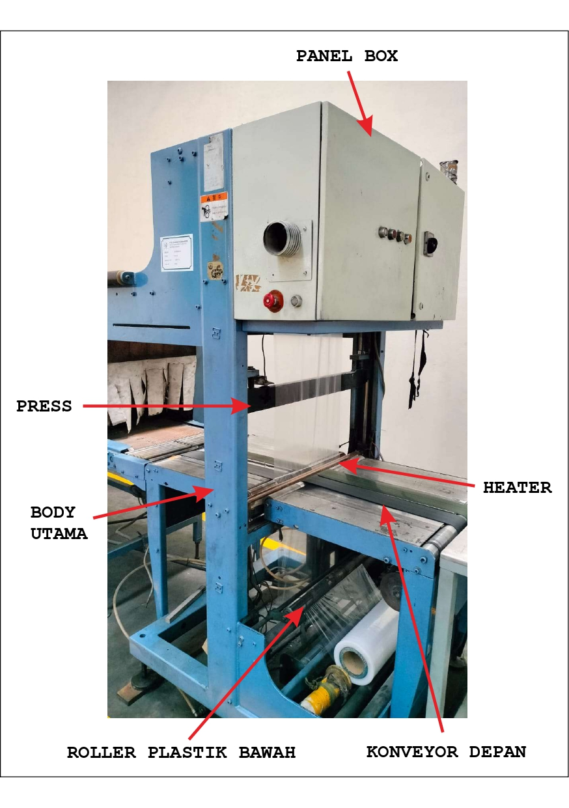
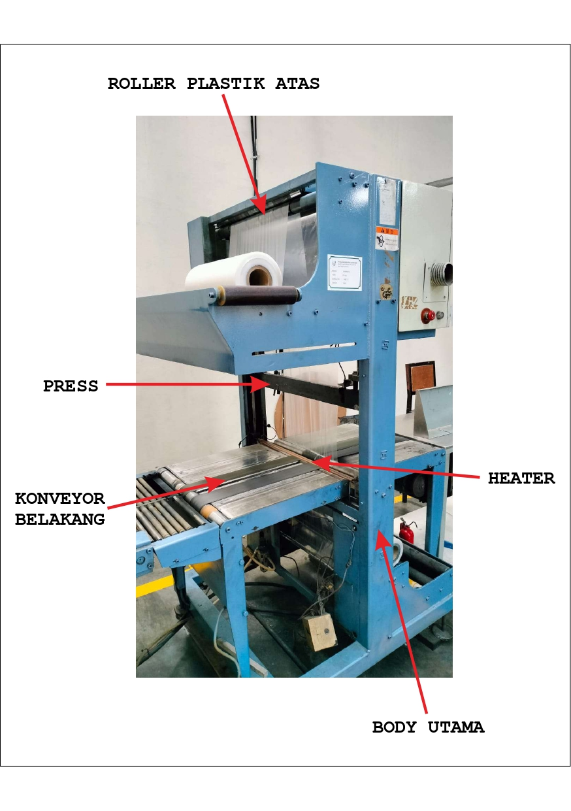
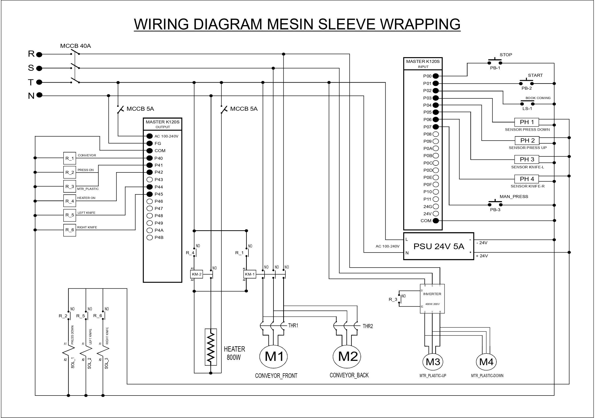
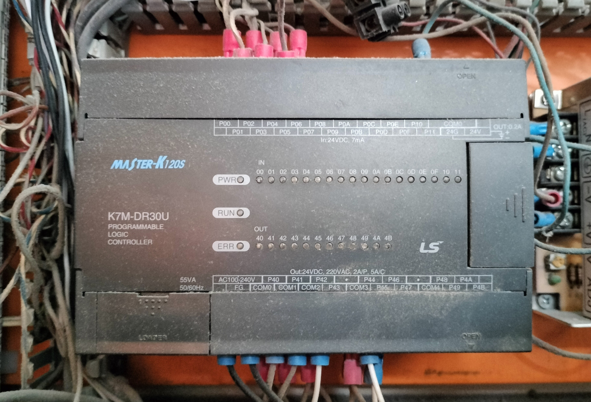
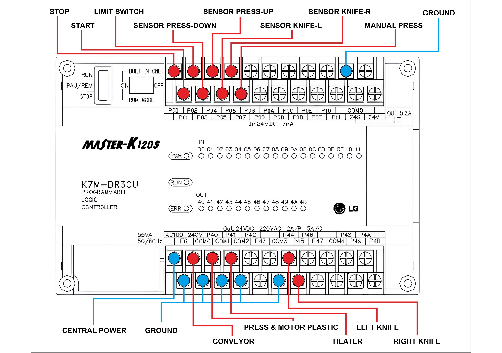
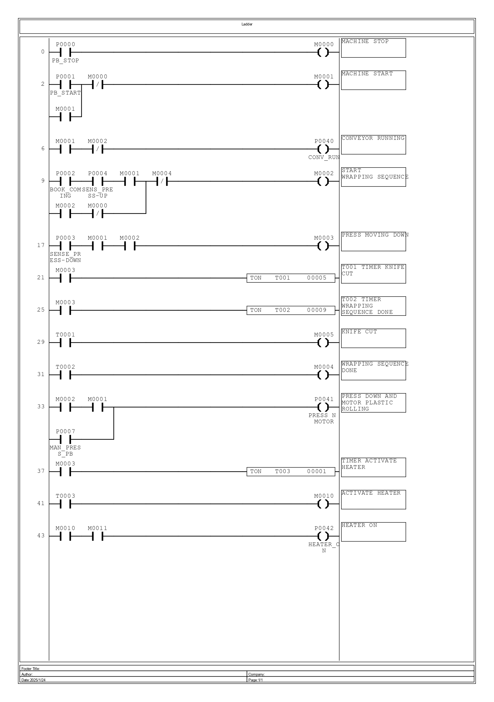
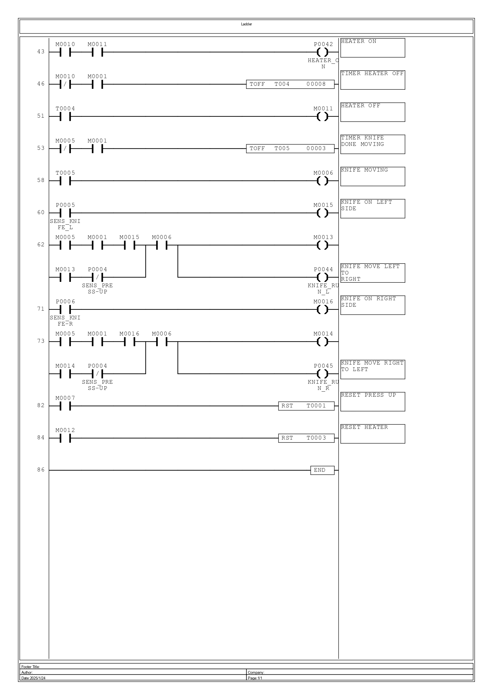
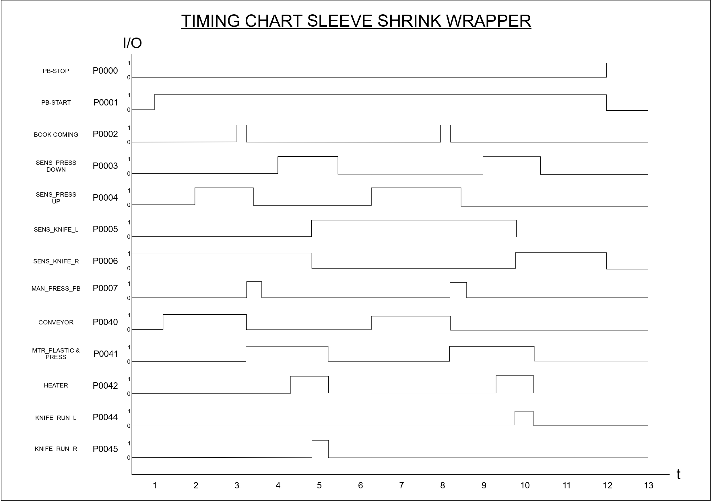
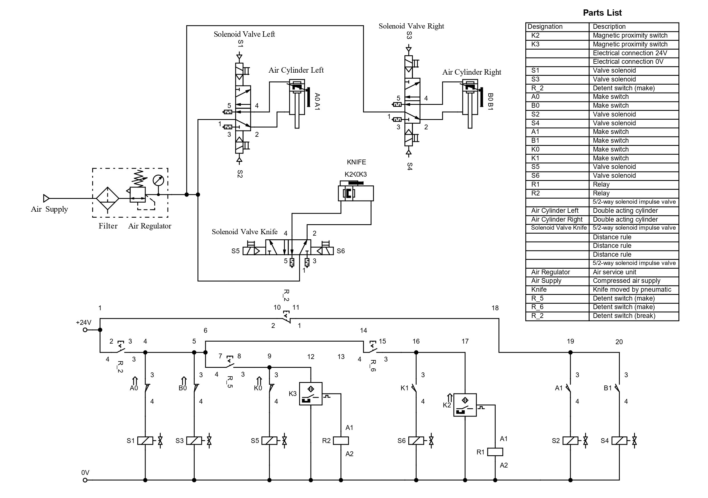

<h1 align="center">
     
    <b>Reverse Engineering: Plastic Wrap Machine Control System</b>
     
</h1>

    <b>Internship Project at OSP PT. Tiga Serangkai (Jan - Feb 2025)</b>
      
    
    
    
    
    
    
      
    It is common practice in the manufacturing industry to substitute relay or mainboard-based control systems with PLCs.
    This upgrade offers significant advantages, such as easier maintenance, reprogrammability, and better connectivity.
    This transition is exactly what happened to a plastic wrap machine at <b>OSP PT. Tiga Serangkai, Surakarta</b>. 
    When its EPROM-based mainboard failed, the control system was upgraded to an <b>LS Master-K120S PLC</b>.
    This project documents the reverse engineering process of the newly implemented PLC system,
    analyzing its integration with the machine's sensors, pneumatics, and motors.
     

## The Plastic Wrap Machine
Plastic wrap machine plays an important part in the book packaging process, 
as its function is to cover and wrap the book entirely in a plastic layer, and is then heated in the oven chamber.
The machine's parts can be easily identified as it is not fully enclosed.
This makes it easier to replace the components if they break or run empty.
There are <b>[electronic parts](diagrams/electronic_parts_list.pdf)</b> and <b>[mechanic parts](diagrams/mechanic_parts_list.pdf)</b>
list that I created to fully breakdown every working component in the machine.

     

## Wiring Diagram
The wiring diagram (or single-line diagram) explains how the machine's components are connected to each other.
It also explains how the machine is energized from the main power.
This <b>[wiring diagram](diagrams/wiring_diagram.pdf)</b> is recreated using a 2D CAD software with approval from my internship mentor.

     

> [!Note]
> The diagram might differ slightly from the real physical configuration due to alterations made during the control system substitution process. But yeah, I did my best.

## PLC Configuration
When the panel box was opened, the LS Master-K120S PLC looked like the picture below (left).
The PLC's I/O connections couldn't be observed clearly, so I make a <b>[PLC configuration scheme](diagrams/plc_configuration.pdf)</b>.
The scheme makes it easier to identify which I/O port is responsible for specific process sequences.

     

## Ladder Diagram
The <b>LS Master-K120S PLC</b> uses <b>KGLwin</b> as its programming software.
Thus, the plastic wrap machine's <b>[ladder diagram](diagrams/ladder_diagram.pdf)</b> could be extracted 
using this software's read program feature.
You can see the entire plastic wrap and sealing sequences from the <b>ladder diagram</b>.

     

## Timing Chart
A <b>[Timing chart](diagrams/timing_chart.pdf)</b> is a chart that shows the timing window of each I/O being executed.
By recording and observing every process sequences and I/O indicators from the PLC, I could build the chart.
It is very useful for analyzing the delay between PLC's process and the actual execution.

    

## Pneumatic Diagram
This <b>[pneumatic diagram](diagrams/pneumatic_diagram.pdf)</b> shows how the pneumatic parts 
like air cylinders, rodless knife, and solenoid valves are working.
<b>Pneumatics</b> are components that are moved by pressurized air instead of electricity, 
and they are usually sourced from an air compressor (which uses electricity).

    

> [!Note]
> I know the diagram doesn't look like its going to be working. I literally just put things together hoping it would look convincing in such a tight time and no basic knowledge about pneumatic at that time.

## Engineering Insight
From thorough observation, I found some problems with the plastic wrap machine components as an after-effect of the control system substitution. 
The right-side air cylinder rod is misaligned during the pressing sequence, causing inconsistency and a loud noise.
This could be fixed by replacing the problematic air cylinder or repairing it at a repair shop.
Another noticeable problem is an emergency button that is no longer working, it even lost its button.
This could cause a major problem if an emergency situation occurs with the worker or machine.
There are plenty I/O ports that could be used as an input for the emergency button, but perhaps they just didn't want to implement it.
<b>This experience taught me that control system upgrades often require strict safety re-evaluation, and machines need to be overhauled or maintained in order to maintain its optimal performance.</b>

## Final Conclusion
This project successfully documented the machine's PLC-based control system, providing comprehensive 
technical diagrams and identifying critical maintenance issues to ensure operational reliability.
It highlights the importance of hardware-software integration and safety compliance in legacy machine upgrades.